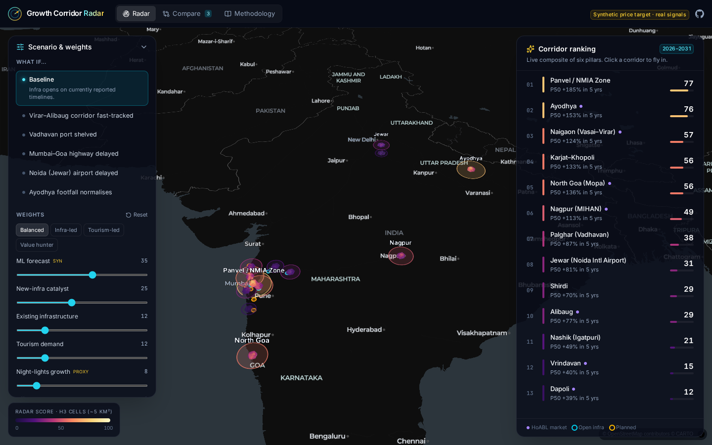
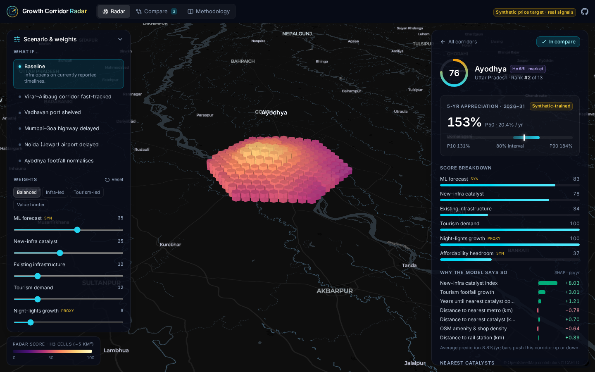
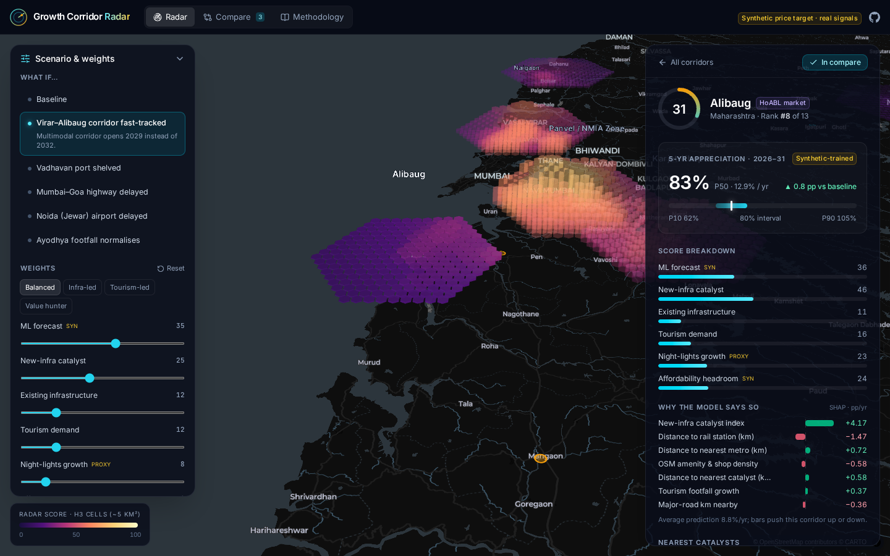
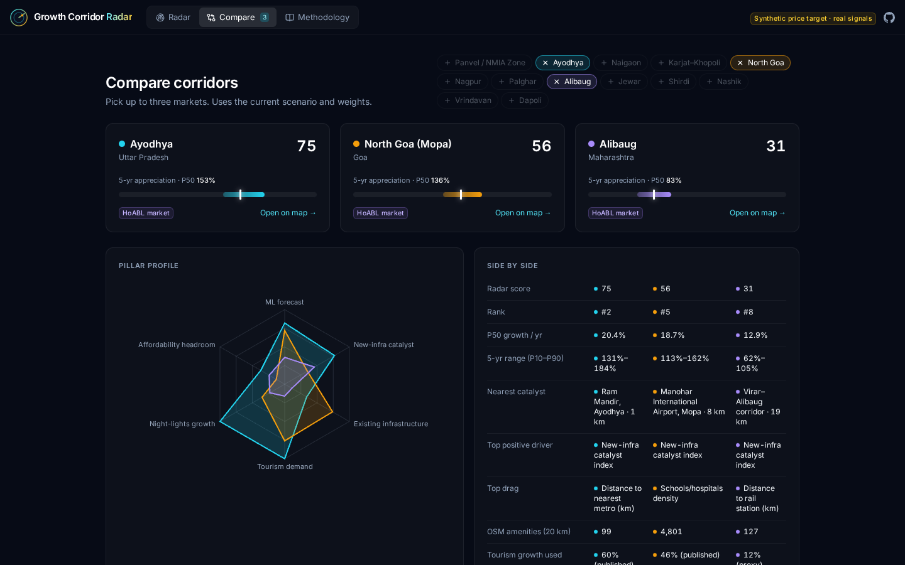
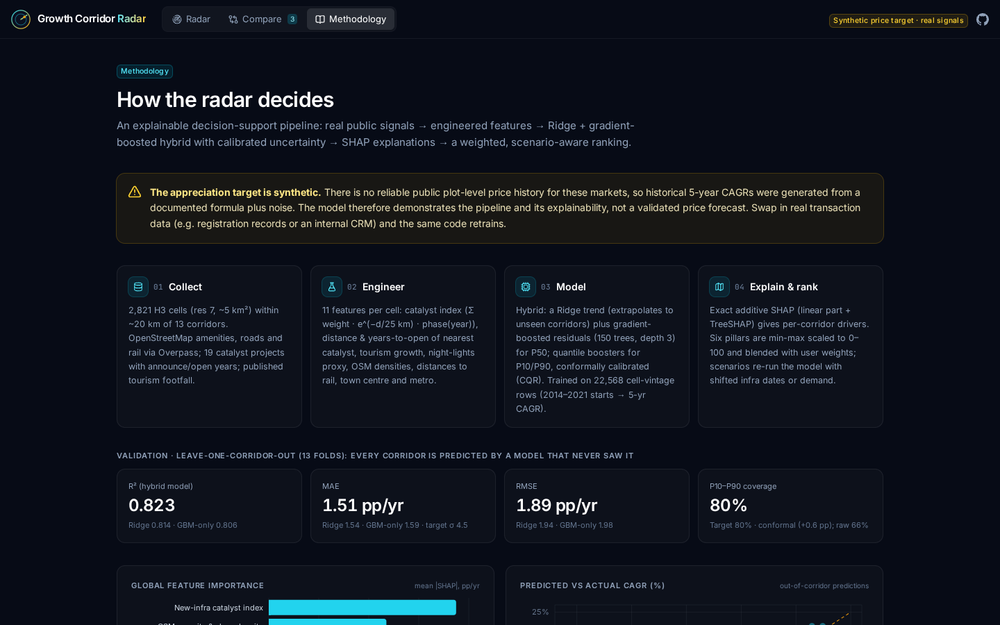

# Growth Corridor Radar

**Which Indian land market will appreciate next, and why?**
An explainable data-science app that ranks 13 growth corridors (Alibaug, Naigaon, Panvel/NMIA, Ayodhya, Vrindavan, North Goa/Mopa, Dapoli, Nagpur and more) on a 3D H3 hexagon map, with live weight sliders, what-if infrastructure scenarios, per-corridor SHAP explanations and calibrated 5-year appreciation ranges.

**Live demo:** https://jiyasingh18.github.io/growth-corridor-radar/ (mirror: https://growth-corridor-radar.vercel.app)



> ⚠️ **Synthetic target.** The historical land-price appreciation used to train the model is *synthetic but calibrated*: there is no reliable public plot-level price history for these markets. Every input signal is real and cited (or explicitly flagged as a proxy). The app labels this everywhere it matters.

| Corridor fact sheet | Scenario: Virar–Alibaug corridor fast-tracked |
|---|---|
|  |  |

| Compare | Methodology |
|---|---|
|  |  |

## What it does
- **3D radar map:** 2,821 H3 cells (resolution 7, about 5 km²) around each corridor, extruded and coloured by a composite score. The camera flies into a corridor when you pick it. Catalyst projects are shown as rings: cyan if open, amber if planned.
- **Live re-ranking:** six pillars (ML forecast, new-infra catalyst, existing infrastructure, tourism demand, night-lights growth, affordability). Drag a slider and the ranking re-sorts with animation.
- **Scenarios:** the model is re-run offline for each what-if: Virar–Alibaug corridor fast-tracked, Vadhavan port shelved, NH-66 delayed, Jewar airport delayed, Ayodhya footfall normalises.
- **Fact sheet:** score ring, P10/P50/P90 5-year appreciation, pillar breakdown, SHAP drivers, nearest catalysts, and an evidence grid where every number is tagged real, proxy or synthetic.
- **Compare:** 2 or 3 corridors on a radar chart, side by side.
- **Methodology:** validation metrics, feature importance, predicted-vs-actual chart, SHAP dependence plot, per-corridor error, and the full source list.

## Model
- **Features (11 per cell-year):** catalyst index `Σ wᵢ·e^(−dᵢ/25km)·phaseᵢ(year)`, distance to and years until the nearest catalyst opens, tourism growth, a night-lights proxy, OSM amenity / social-infra / major-road density, and distances to rail, town centre and the nearest metro.
- **Training set:** 22,568 cell × vintage rows (5-year windows starting 2014–2021).
- **Model:** a hybrid of a RidgeCV trend plus gradient-boosted residuals. The linear part extrapolates to unseen corridors; the trees capture interactions. P10/P90 come from quantile boosters, widened with conformalized quantile regression (CQR).
- **Validation:** leave-one-corridor-out (13 folds). Hybrid R² **0.823** vs Ridge 0.814 vs GBM-only 0.806; MAE 1.51 pp/yr. P10–P90 coverage is 66% raw and 80% after CQR.
- **Explainability:** exact additive SHAP, i.e. the linear term `coef·(x − x̄)` plus TreeSHAP on the residual booster.

## Data sources
- OpenStreetMap via the Overpass API (© OpenStreetMap contributors, ODbL)
- UP Tourism Dept: Ayodhya 2017–2024 visitors (via [PTI](https://www.ptinews.com/stories-detail/national/record-tourist-footfall-in-ayodhya-this-year-more-to-visit-for-deepotsav/3020052/0)); Mathura 2023–24 (via [Times of India](https://timesofindia.indiatimes.com/city/lucknow/up-sees-65-crore-tourists-in-2024-over-17-crore-more-from-2023/articleshow/117610333.cms))
- [Goa Economic Survey 2024-25](https://www.dpse.goa.gov.in/Economic-Survey-2024-25.pdf): tourist arrivals 2015–2024
- Project pages for MTHL, Navi Mumbai airport, Mopa, Ayodhya airport, Samruddhi, Jewar, Vadhavan, Mumbai–Ahmedabad HSR, the Virar–Alibaug corridor and NH-66 (links in `pipeline/infra.json`)
- Basemap © CARTO
- **Proxy:** night-lights growth (NASA Black Marble needs an Earthdata login; see `pipeline/README.md`)
- **Synthetic:** land price level and appreciation history

## Run locally
```bash
cd web && npm ci && npm run dev          # http://localhost:5173/growth-corridor-radar/
# rebuild data/model (optional):
pip install -r pipeline/requirements.txt && python pipeline/build_and_train.py
```

## Deploy
The app is fully static (no server, no keys). `scripts/deploy-pages.sh` builds `web/` and publishes `web/dist` to the `gh-pages` branch, which GitHub Pages serves.

## Stack
Vite · React 19 · TypeScript · Tailwind CSS v4 · deck.gl 9 (H3HexagonLayer) · MapLibre GL · Recharts · Python (pandas, scikit-learn, SHAP, h3)

See **[EXPLAINER.md](EXPLAINER.md)** for a plain-English walkthrough, demo script and likely interview questions.
